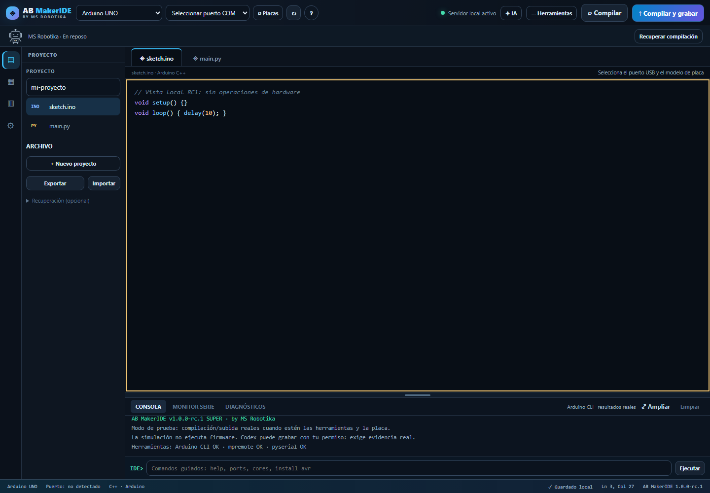

# AB MakerIDE SUPER 1.0.0-rc.1 · MS Robotika

**De una idea a firmware verificable, en un IDE local y abierto.**

AB MakerIDE reúne Arduino C++, MicroPython, herramientas de placa y agentes opcionales en una interfaz en español. Puedes ver el código que crea el agente, conservarlo, compilarlo y comprobar cada etapa de la tarea. Proyecto de **MS Robotika**, con [licencia MIT](LICENSE).

**Estado: 1.0.0-rc.1, candidato de lanzamiento.** Validado localmente en Windows, con pruebas físicas de radar IdeaSpark, ESP32-CAM, WROOM con MicroPython, Nano y Mega documentadas en la [matriz de hardware](docs/MATRIZ_HARDWARE.md). Estas pruebas corresponden a esos dispositivos concretos; quedan por ampliar las placas, escenarios y sistemas operativos para declarar v1.0 estable.

[English overview](README.en.md) · [Guardar proyectos del agente](docs/PROYECTOS_DEL_AGENTE.md) · [Comparativa](docs/POSICIONAMIENTO_2026-10-25.md) · [Contribuir](CONTRIBUTING.md)



Captura real del servidor local RC1. [Galería y alcance de las evidencias](docs/evidence/README.md).

## Qué ofrece

- Editor para Arduino C++ y MicroPython con guardado local, exportación y recuperación de sesiones.
- Catálogo de placas desde las herramientas instaladas; selección de modelo separada del puerto USB.
- Compilación, grabación, monitor serie y diagnóstico desde la interfaz.
- Agentes opcionales Codex CLI y Claude Code, con permisos visibles y registro de actividad.
- Apertura del código generado con copia del anterior, descarga del sketch y ZIP con auxiliares. Continuar y compilar conservan las cabeceras creadas por el agente.
- Robot MS Robotika: ámbar durante el trabajo, verde para el resultado concreto acreditado y rojo con error, acompañado de texto.

El editor y las herramientas locales pueden usarse sin una cuenta de IA. **MakerIDE no incluye saldo, suscripciones ni acceso gratuito a IA: cada usuario vincula su propia cuenta del proveedor y asume su consumo.** Los agentes externos pueden utilizar la red y recibir el código de la tarea. Codex ha sido probado en uso real por el autor. Claude Code, los conectores de chat y Ollama siguen pendientes de validación equivalente; su presencia en el menú no acredita una cuenta conectada ni una prueba correcta.

En **Herramientas → Pruebas de mis placas** puedes guardar el resultado de la herramienta junto al modelo/puerto seleccionados y tu observación del dispositivo, y exportar el cuaderno. [Guía de pruebas](docs/PRUEBAS_DE_PLACAS.md).

## Demostración verificable

El [radar IdeaSpark](examples/ideaspark_114_radar.ino) es un ejemplo de un solo archivo para ESP32 y pantalla ST7789. Se compiló y grabó en COM4 con autorización y verificación del grabador; el usuario confirmó que lo ve. Los cuatro ecos son **simulados**. [Registros y perfil exacto](docs/evidence/radar-ideaspark/README.md).

La **ESP32-CAM con sensor OV3660** pasó una prueba autorizada con respaldo previo de 4 MB y grabación verificada. El diagnóstico detectó PSRAM y reportó cinco fotogramas JPEG de 320x240 sin errores durante 16 segundos. No se transmitieron imágenes ni se evaluó su aspecto visual. [Código exacto y registros](docs/evidence/esp32cam/README.md).

La **ESP32-WROOM con MicroPython 1.29.0** pasó una prueba finita en RAM: cinco muestras de memoria, aritmética, JSON y temporización, además de lectura del sistema de archivos. Se resolvió antes un controlador CP2102 ausente y se instaló el firmware con autorización, respaldo completo y verificación. No se probaron GPIO ni red y no se guardó main.py. [Código y evidencias](docs/evidence/wroom-micropython/README.md).

El **Arduino Nano ATmega328P con cargador antiguo** pasó una carga autorizada, con respaldo previo de flash y EEPROM y verificación independiente. Se observaron cinco muestras correctas por serie y la EEPROM siguió intacta. No se probaron GPIO ni periféricos externos. [Código y registros](docs/evidence/arduino-nano/README.md).

El **Arduino Mega 2560** pasó una carga autorizada con copia previa de 256 KB de flash y 4 KB de EEPROM, verificación independiente y cinco muestras correctas por serie. La EEPROM se conservó. No se probaron GPIO externos ni otros periféricos. [Código y registros](docs/evidence/arduino-mega/README.md).


La mejora de proyectos y cuaderno pasa **199 pruebas unitarias**, con otras 4 omitidas por falta de g++, y **37 comprobaciones de interfaz**. Las pruebas de interfaz del agente son controladas; no se presentan como ejecuciones de IA o grabaciones reales. [Resultados del cuaderno](docs/evidence/board-trials/README.md) y [pruebas previas de proyectos](docs/evidence/agent-projects/README.md).

## Arranque en Windows

1. Conserva la carpeta anterior. No sobrescribas v0.9.5 ni tus proyectos.
2. Ejecuta `INICIAR_WINDOWS.bat` (Python 3.10+). Usa **http://127.0.0.1:8770**, dejando libre de cambios el servidor anterior de 8765.
3. `/api/health` debe devolver `1.0.0-rc.1`. Arduino CLI se busca en PATH y en `C:\Program Files\Arduino CLI`. Para una ruta específica, define `AB_MAKERIDE_ARDUINO_CLI` antes de arrancar. El servidor no cambia PATH ni configuración global.
4. Elige **modelo** y **puerto** por separado. «Placas» busca los modelos instalados, en páginas de 40. CH340 y CP210x identifican un conversor USB, nunca prueban el modelo de placa. Una sugerencia de la CLI no reemplaza tu modelo.
5. Pulsa **Compilar** y revisa la consola. La grabación y el monitor serie son acciones independientes. El ejemplo radar se grabó con autorización; otras placas, periféricos y escenarios requieren su propia validación.

Arranque directo: `python server.py --no-browser --port 8770`. Linux/macOS: `./iniciar_linux_mac.sh`. Las funciones serie/MicroPython usan las dependencias opcionales de `requirements.txt`; no hacen falta para abrir el editor ni para Arduino CLI.

## Robot y resultados

El robot SVG local lleva antena, ojos, brazos y distintivo MS. También informa con texto accesible, sin depender del color. Respeta «reducir movimiento».

| Estado | Significado |
| --- | --- |
| Neutro | Reposo, cancelación, interrupción o resultado sin verificar |
| Ámbar pulsante | Hay tareas en curso; no se inventan porcentajes de compilación |
| Verde | Resultado concreto verificado: compilador/grabador con salida 0, CLI de agente con salida 0 y registro, o comprobación de sintaxis Python |
| Rojo | Fallo de herramienta o consulta de red; un resultado desconocido no se convierte en éxito |

El éxito del agente **solo confirma la finalización de su CLI**. No prueba compilación, grabación ni funcionamiento físico. Una tarea pendiente impide el verde global; un fallo no desaparece por el éxito de otra tarea. Al editar o cambiar placa se invalida la compilación anterior. Los resultados incluyen FQBN y SHA-256 de la revisión compilada.

## Recuperación y compatibilidad

El código creado por el agente se puede abrir en el editor con copia del anterior, guardar como sketch o descargar con sus archivos auxiliares en ZIP. Los auxiliares se conservan al continuar y compilar el proyecto. [Guía de guardado, reapertura y radar IdeaSpark](docs/PROYECTOS_DEL_AGENTE.md).

- Los dos archivos, nombre, FQBN y puerto conservan la clave compatible `ab-makeride-project-v2`. Se guarda al editar y al abandonar/recargar la página. Un puerto desconectado permanece como referencia sin confirmar su presencia.
- Cada origen del navegador tiene su almacenamiento: **8770 no puede leer automáticamente los proyectos de 8765**. Exporta `.abmaker.json` en la versión anterior e impórtalo aquí. No se accede a perfiles de navegador existentes.
- El launcher y el servidor usan `.makeride-data` dentro de esta carpeta. `AB_MAKERIDE_DATA_DIR` permite elegir otra carpeta. Para recuperar sesiones antiguas, copia primero su carpeta `AgentWorkspaces` a ese directorio de datos; no es necesario modificar el original.
- `BuildSessions/<id>` conserva `sketch.ino`, destino y registro de compilación. La referencia se guarda antes del POST; repetir la misma referencia no ejecuta otra operación. «Recuperar compilación» consulta el resultado; nunca repite una grabación.
- Tras reiniciar, una tarea que figuraba activa se presenta como interrumpida y con resultado desconocido. La lectura de sesiones antiguas no reescribe sus archivos. Los registros antiguos sin `exit_code` no encienden el verde del agente.
- Si otra pestaña cambia el proyecto, se pausa el guardado para evitar sobrescribirla: exporta la copia que quieras conservar antes de recargar. Un almacenamiento dañado también pausa el guardado y conserva el valor original. No borres datos del navegador sin exportar.

## Verificación reproducible

`python tests/run_isolated.py` ejecuta toda la suite en datos temporales. `node --test tests/robot_status.test.cjs` verifica los estados del robot. No se necesita cuenta de IA ni placa para estas regresiones. Los uploads de tests están aislados con mocks.

La aceptación visual utiliza Playwright/Chromium con un servidor HTTP real, un perfil propio y directorios temporales. Instalación opcional, siempre local:

```powershell
python -m venv C:\ruta\work\test-venv
C:\ruta\work\test-venv\Scripts\python.exe -m pip install playwright==1.56.0
$env:PLAYWRIGHT_BROWSERS_PATH='C:\ruta\work\browsers'
C:\ruta\work\test-venv\Scripts\python.exe -m playwright install chromium
C:\ruta\work\test-venv\Scripts\python.exe tests/browser_acceptance.py --work C:\ruta\work\acceptance-nueva --outputs C:\ruta\outputs --port 8770
```

Usa un directorio de aceptación nuevo y un puerto libre. Esta prueba compila con los núcleos instalados, bloquea operaciones reales de grabación/serie/agentes y distingue sus escenarios interceptados. Auditoría de solo lectura: `python tests/audit_real_arduino.py --output C:\ruta\outputs\arduino-audit.json`.

Resultados, capturas, cambios y pendientes: [informe RC1](docs/RELEASE_RC1.md), [evidencias](docs/evidence/README.md). Los informes v0.9.x son históricos y no sustituyen esta verificación. No se ha hecho push, publicación ni PR.

Licencia MIT para MakerIDE. Marcas, herramientas, núcleos y bibliotecas externas mantienen sus propias licencias.
