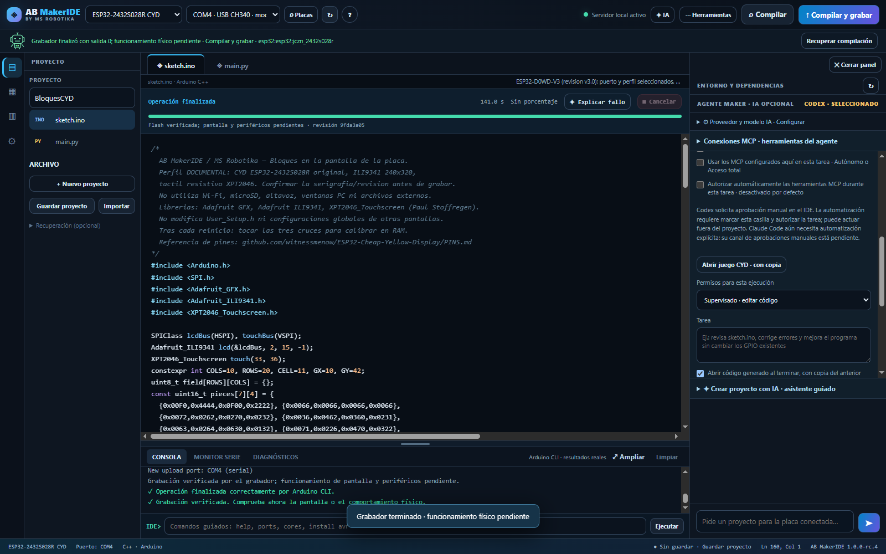

# AB MakerIDE SUPER 1.0.0-rc.4 · MS Robotika

 

**[Descargar RC4](https://github.com/msrobotika/AB-MakerIDE-SUPER/releases/tag/v1.0.0-rc.4)** · [Comunicar un fallo](https://github.com/msrobotika/AB-MakerIDE-SUPER/issues/new/choose) · [Proyectos y pruebas de placas](https://github.com/msrobotika/AB-MakerIDE-SUPER/discussions) · [English](README.en.md)

**Un editor con agente para crear firmware de Arduino, ESP32 y MicroPython.** Pide el proyecto desde el chat, trabaja con el código en el editor y distingue cada resultado: código, compilación, carga verificada y observación física.

La aplicación es open source, con [licencia MIT](LICENSE). **La IA es opcional y no es gratuita por incluir MakerIDE:** cada usuario vincula su propia cuenta y utiliza su cuota. Codex está probado en uso real por el autor. Claude Code, conectores de chat y Ollama siguen pendientes de validación equivalente.

## Nuevo en RC4

- **MCP manual por defecto en Codex.** Cada solicitud aparece en el IDE con sus argumentos y necesita una decisión. La aprobación automática es una opción visible, desactivada al abrir y limitada a esa ejecución. Claude Code conserva su estado experimental y bloquea el modo MCP manual hasta integrar sus aprobaciones nativas. [Permisos y compatibilidad](docs/MCP.md).
- **Credenciales protegidas:** DPAPI del usuario en Windows; llavero del sistema en Linux/macOS con backend compatible. Sin llavero no se crean nuevos archivos en texto plano: la configuración nueva vive solo en RAM y el panel lo indica. El JSON temporal de Claude contiene referencias a variables, no sus valores.
- **Frontend en módulos ES**, código formateado y sin asignaciones a `innerHTML`. Estilos externos y CSP sin `unsafe-inline`, con `style-src-attr 'none'`. [Arquitectura y desarrollo](docs/DESARROLLO.md).
- **VERSION es la fuente de la versión** del servidor, interfaz y cuadernos de prueba. Ruff, ESLint, Prettier, Dependabot e integridad SHA-256 forman parte de CI.
- Servicios Python en `ab_makeride/`, tests por funcionalidad y documentos históricos en `docs/archive/`. El vídeo original pasa a los adjuntos de Releases; no se reescribe el historial Git.
- Preparación y arranque equivalentes en Linux/macOS, más CI en macOS. [Instalación y permisos serie](docs/LINUX_MACOS.md). La validación física sigue siendo en Windows.

Se conservan el **inicio vacío**, el guardado manual con **Ctrl+S**, la importación del proyecto y la separación entre compilación, carga verificada y observación física. Recuperar un registro no repite una grabación.

[Flujo del agente, guardado y límites](docs/PROYECTOS_DEL_AGENTE.md) · [Identificación](docs/IDENTIFICACION_AUTOMATICA.md) · [Cambios](CHANGELOG.md)

## Empezar en Windows

1. Extrae el ZIP en una carpeta nueva y conserva tus versiones y archivos anteriores.
2. Con Python 3.10 o posterior, abre **INICIAR_WINDOWS.bat**. La dirección predeterminada es **http://127.0.0.1:8770**. El lanzador no cierra un proceso que ya ocupe el puerto.
3. El editor y el simulador funcionan sin dependencias opcionales. **PREPARAR_WINDOWS.bat** prepara serie/MicroPython en la `.venv` de esta copia. Arduino necesita Arduino CLI y el núcleo de la placa.
4. Conecta la placa. Cuando puede identificar una única conexión, el IDE selecciona puerto y perfil instalado. La elección manual prevalece. El modelo comercial, la pantalla y su revisión necesitan datos suficientes; no se adivinan por el conversor USB.
5. Describe el proyecto en el chat y elige el permiso del agente. Una carga necesita una petición inequívoca y el puerto confirmado. El resultado de la herramienta y lo que observas en el dispositivo se registran por separado.
6. Pulsa **Guardar proyecto** si quieres conservar el código. Una nueva apertura empieza vacía.

[Instalación y recuperación](docs/INSTALACION.md). La consulta del chip puede reiniciar la placa; no escribe firmware. Los datos operativos del agente se guardan en `.makeride-data`, o en `AB_MAKERIDE_DATA_DIR`, para diagnóstico y recuperación explícita. No convierten el borrador del editor en un archivo guardado por el usuario. Las claves de los conectores de chat permanecen en memoria del servidor; las cuentas CLI se gestionan mediante sus herramientas oficiales.

## Herramientas y evidencia

Incluye editor Arduino C++/MicroPython, catálogo de modelos instalados, compilación, carga, monitor serie, diagnóstico, agente opcional, exportación/importación y un [simulador de secuencias digitales](docs/SIMULADOR.md). El simulador no emula firmware ni acredita funcionamiento físico. El [cuaderno de placas](docs/PRUEBAS_DE_PLACAS.md) guarda pruebas cuando el usuario lo solicita.

Hay pruebas físicas documentadas de **seis dispositivos concretos**: radar IdeaSpark, ESP32-CAM, WROOM con MicroPython, Nano con cargador antiguo, Mega 2560 y CYD con pantalla táctil. La CYD recibió primero bloques y después [Space Invaders](docs/evidence/cyd-space-invaders/README.md): dos respaldos de flash coincidentes, firmware completo compilado, cuatro bloques de grabación verificados y marcador serie. El usuario confirmó que tenía el juego. Esto no acredita cualquier revisión ni una prueba prolongada de todos sus periféricos.

[Matriz de hardware](docs/MATRIZ_HARDWARE.md) · [Radar](docs/evidence/radar-ideaspark/README.md) · [Cámara](docs/evidence/esp32cam/README.md) · [MicroPython](docs/evidence/wroom-micropython/README.md) · [Nano](docs/evidence/arduino-nano/README.md) · [Mega](docs/evidence/arduino-mega/README.md) · [Bloques CYD](docs/evidence/cyd/README.md)

La suite local RC4 pasa **294 de 299 pruebas unitarias**, con cinco omisiones por herramientas/privilegios/plataforma. Los ocho flujos de navegador suman **196 comprobaciones**. Se incluyen pruebas de inyección y CSP, una aprobación MCP con el Codex instalado y una compilación real Uno sin grabación. [Resultados y límites](docs/evidence/rc4/README.md) · [Respuesta punto por punto a la revisión](docs/AUDITORIA_RC4.md).

**Estado: candidato de lanzamiento, validado físicamente en Windows.** CI ejecuta unidades en Windows, Ubuntu y macOS y navegador en Chromium; no acredita por sí sola instalación interactiva, controladores USB ni hardware de Linux/macOS.

[Seguridad local](SECURITY.md): loopback, Host/Origin exactos, token por proceso y límites de rutas/archivos. Los permisos del agente son los de su CLI; el modo supervisado no constituye un sandbox del sistema operativo.

[Contribuir](CONTRIBUTING.md) · [Licencia MIT](LICENSE) · [Compartir pruebas de Linux y macOS](https://github.com/msrobotika/AB-MakerIDE-SUPER/discussions)

[IA, cuentas y opción online con cuota gratuita](docs/IA_Y_CUOTAS.md).

[Prueba real de carga manual CYD desde RC4](docs/evidence/cyd-rc4/README.md): respaldo comprobado, una carga desde la interfaz, cuatro hashes verificados, guardado con Ctrl+S y pantalla/táctil confirmados por el usuario.
