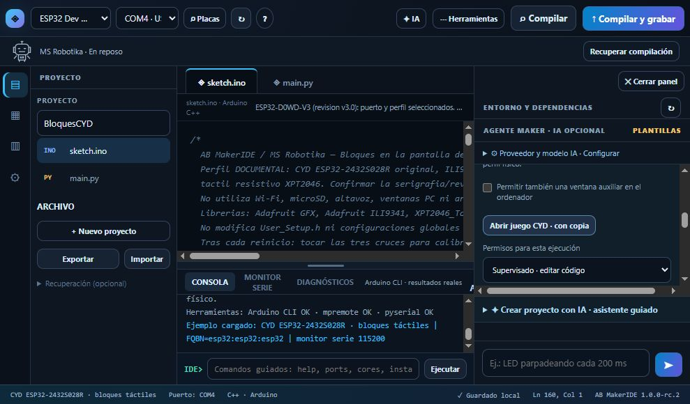

# CYD: juego en pantalla física y táctil

25 octubre 2026. Perfil ESP32-2432S028R / ILI9341 240×320 + XPT2046. El usuario aportó una referencia de este modelo; esptool leyó ESP32-D0WD-V3 revisión 3.0 en COM4, con 4 MB de flash. El chip no determina por sí solo la revisión de pantalla.

Antes de sustituir el programa se obtuvieron dos lecturas completas independientes de flash con SHA-256 idéntico. Las imágenes permanecen privadas: contienen el programa anterior, no una imagen de fábrica. El usuario autorizó expresamente conservar copia y cargar el juego.

El [sketch de un archivo](../../../examples/cyd_28_bloques_tactil.ino) compiló con Arduino CLI 1.5.1 y núcleo ESP32 3.3.12: 317747 bytes de programa y 24908 de RAM estática. Se cargó a 115200 baudios con salida 0 y verificación de los cuatro bloques por el grabador. Las herramientas se ejecutaron directamente; esta carga no acredita haber pulsado Compilar y grabar desde el navegador.

La primera versión borraba la pantalla en cada caída. Tras el aviso del usuario se cambió a repintado de celdas modificadas, se recompiló y cargó con verificación. El usuario confirmó posteriormente: **las piezas caen sin parpadeo y funcionan los controles táctiles**. Es una observación explícita del usuario, no un vídeo independiente nuevo.

La calibración de tres cruces se mantiene en RAM y se repite al reiniciar. La consulta automática del chip también puede reiniciar la placa. No se usa Wi-Fi, altavoz ni microSD; no se monta ni escribe la tarjeta. No se acredita estabilidad prolongada, otra revisión CYD ni compatibilidad universal.

[Resultado estructurado y hash del sketch](resultado.json). La imagen muestra el IDE local RC2 con COM4 y el código abierto; no es una fotografía del dispositivo ni evidencia visual de su pantalla.

