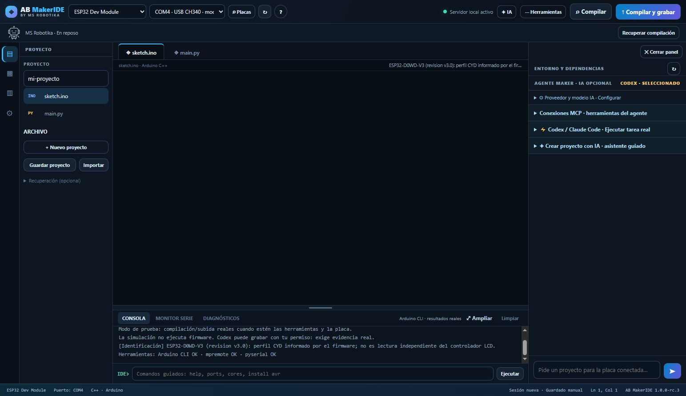
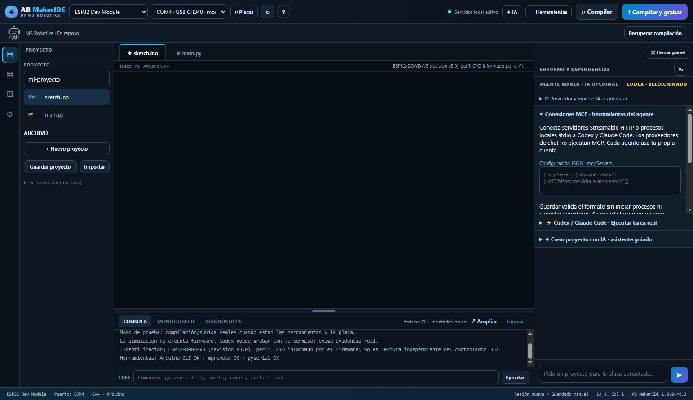

# Validación RC3 · sesión nueva, agente, proyectos y MCP

Validación local en Windows, 25 de octubre de 2026. Los informes públicos conservan comprobaciones y resultados sin credenciales ni rutas privadas. Las copias de firmware y carpetas de sesiones originales no se publican.

## Resultados

- **Unidades:** 281 pruebas, 277 correctas y cuatro omitidas (g++ no disponible y privilegios de enlaces simbólicos en Windows). Véase `unitarios.json`.
- **Interfaz controlada:** 148 comprobaciones entre consentimiento del agente (43), inicio limpio/guardado manual (20), recuperación (23), simulador (27), identificación/selección (21) y configuración MCP (14). HTTP local y Chromium reales, con CLIs, puertos o respuestas controladas según el alcance de cada informe. No son pruebas físicas.
- **Aceptación adicional:** 41 comprobaciones, con catálogo instalado y compilación real Arduino Uno sin acceso a pines, error de compilación real, revisión del hash del código, reinicio del servidor propio de la prueba y escenarios interceptados de fallo. No se abre serie ni se carga firmware. Véase `aceptacion.json`.
- **Codex instalado/cuenta real:** respuesta de diagnóstico en modo lectura y chat del IDE hacia una tarea real con consentimiento. No hubo compilación o carga en esos diagnósticos. Véase `cli-real.json`.
- **MCP real con Codex:** inicialización, descubrimiento y una llamada a herramienta de prueba local por stdio; también por Streamable HTTP local con autenticación comprobada por el receptor. No se usa hardware ni un servicio externo desde los servidores de prueba. Véanse `mcp-stdio-real.json` y `mcp-http-real.json`. Esto no valida todos los servidores ni Claude Code.

Los informes de MCP diferencian `mcp_calls` de las evidencias de firma, compilación o grabación; una llamada de herramienta no pone a verdadero esas evidencias físicas. Las pruebas controladas incluyen fallo MCP con salida CLI 0 y recuperación posterior de la misma herramienta.

## Comportamiento esperado

Cada apertura empieza vacía. No se recuperan ni repiten tareas o grabaciones automáticamente. Las preferencias de IA y la configuración MCP se conservan; su activación adicional requiere selección y autorización por tarea. El guardado del código es manual mediante descarga JSON/ZIP, y el ZIP conserva auxiliares y la edición actual. Importar no ejecuta el proyecto.

Si se solicita cargar y falta verificación, la tarea continúa pendiente. Si falla una herramienta MCP y no se recupera, el resultado se marca como fallido aunque la CLI termine con salida 0. Las evidencias de comandos de Codex se extraen de eventos completados correctamente, no de mensajes de la IA.

## Capturas

Las capturas muestran el IDE instalado y su estado real; no simulan una conexión MCP del usuario ni una grabación física nueva. Las pruebas físicas documentadas se conservan separadas en la [matriz](../../MATRIZ_HARDWARE.md) y la evidencia de [Space Invaders CYD](../cyd-space-invaders/README.md).
