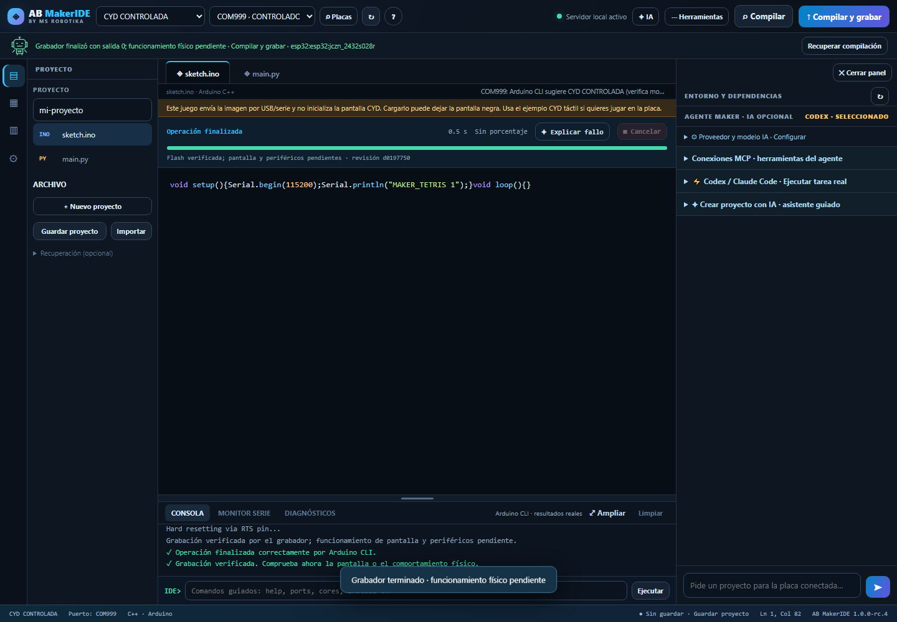
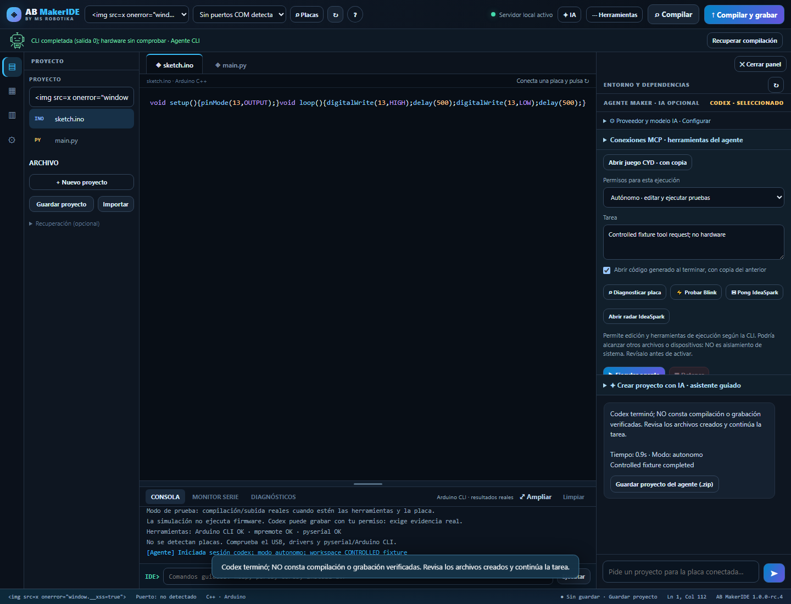

# Validación RC4 · 26 octubre 2026

Resultados del propio proyecto; no constituyen una auditoría independiente ni una garantía de funcionamiento de todos los dispositivos.

| Comprobación | Resultado y alcance |
| --- | --- |
| Unidades locales Windows | 294/299 correctas; 5 omitidas por g++/privilegios de enlaces/plataforma. Datos temporales, herramientas controladas salvo los casos que declaran un subproceso local real. |
| Ocho recorridos Chromium | 196 comprobaciones correctas: consentimiento, reconexión, simulador, identidad, inicio/guardado, MCP, inyección/CSP y carga manual. Hardware sustituido por fixtures; no certifican una carga física. |
| Aceptación adicional | 41 comprobaciones, incluida compilación real de Uno con Arduino CLI y escenarios controlados separados. Sin escritura de flash ni apertura de serie en ese recorrido. |
| Codex/MCP real | Una llamada stdio autorizada manualmente, marcador `MSR_MCP_PROBE_OK`, tarea correcta. En un ensayo posterior la herramienta terminó, pero la cuota de la cuenta impidió cerrar el turno: se registra como fallo, sin nuevo consumo para reintentar. |
| Credenciales | DPAPI real en Windows, migración y roundtrip. Backends de llavero POSIX con dobles; no se afirma una sesión real Keychain/SecretService/KWallet. |
| Calidad | Ruff, ESLint y Prettier ejecutados localmente. CI añade Windows, Ubuntu, macOS, navegador e integridad. Consulta el estado del commit en GitHub; los resultados locales no sustituyen esa ejecución. |

[Resultados por caso](validation.json) · [MCP con CLI instalada](codex-mcp-real.json) · [Respuesta a la auditoría](../../AUDITORIA_RC4.md).

## Carga manual controlada

El recorrido usa servidor HTTP, gestor de trabajos, diario y frontend reales, con salida de compilador/grabador sustituida y COM999 ficticio. Comprueba decimales de esptool, final de consola, revisión exacta, verificación solicitada, ausencia de verde sin evidencia, error de compilación, cancelación, exclusión de monitor/agente y ausencia de acciones en cola. Las confirmaciones nativas del navegador están deshabilitadas durante la prueba: se usan los diálogos del IDE.

## Texto hostil y CSP

Se introducen cadenas con HTML ejecutable en código, nombre de proyecto, catálogo y autorización MCP. Permanecen como texto; no ejecutan JavaScript. Redimensionar la terminal y abrir el simulador no genera violaciones CSP. Una aprobación se envía una sola vez; repetir la misma solicitud devuelve 400.

## Límites

Claude Code no se ha ejecutado con una cuenta real y su aprobación manual MCP se bloquea. Gemini API dispone de modelos configurables y pruebas de contrato/UI, pero falta una cuenta real para validar su respuesta; no se presenta como agente con herramientas. Linux/macOS en CI no equivale a pruebas físicas en esos equipos. Las evidencias anteriores de seis placas conservan su alcance original.

El vídeo original se adjunta a Releases y desaparece del árbol actual. Sigue presente en commits y etiquetas anteriores: no se ha reescrito el historial.
