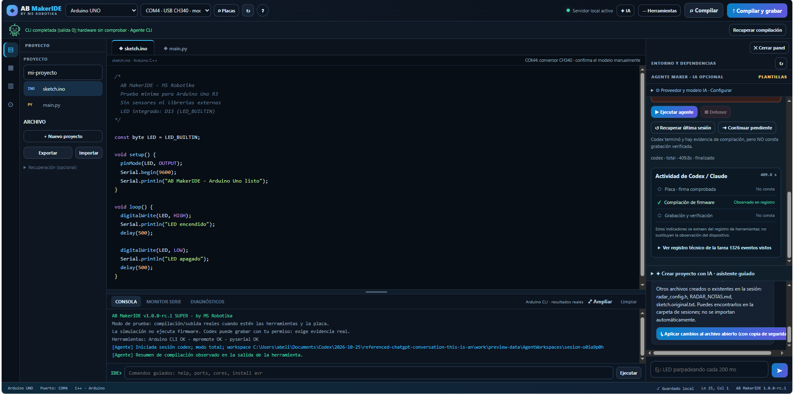
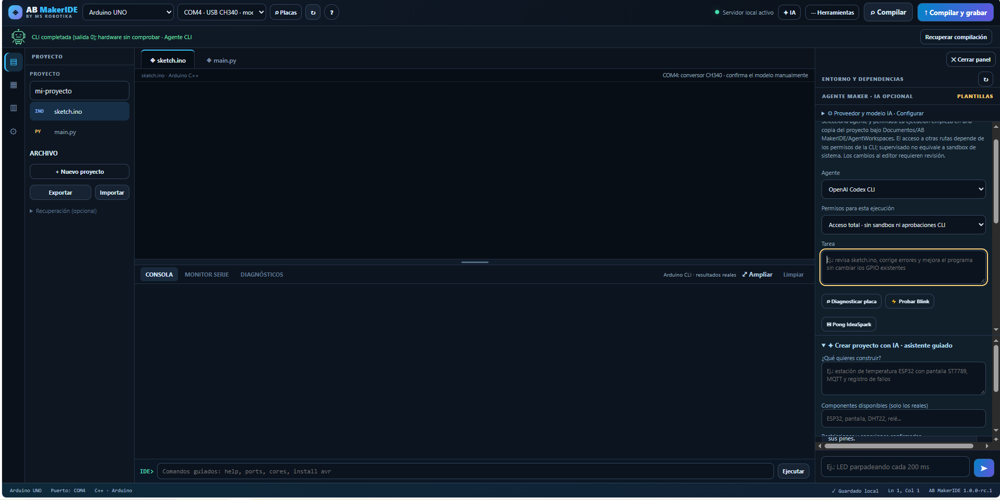

# Capturas del robot aportadas por el usuario

Se conservan sin edición las capturas 134 y 135. Sus originales y hashes están registrados en metadata.json.

Ambas muestran el robot verde y el texto «CLI completada (salida 0); hardware sin comprobar · Agente CLI». No son capturas de dos colores diferentes.

En la 134, el panel declara evidencia de compilación, pero «Grabación y verificación: No consta». La selección del IDE sigue siendo Arduino Uno, COM4/CH340. Esa selección no identifica la placa ESP32 real. En la 135 se ve el modo de acceso total y el mismo estado verde.

Estas imágenes documentan el fin de la CLI y la distinción textual respecto al hardware; no prueban la carga del radar, el funcionamiento físico de la pantalla ni los estados ámbar/rojo. El verde global de la CLI tampoco demuestra que se hayan cumplido todos los objetivos de una petición que incluya grabación.

