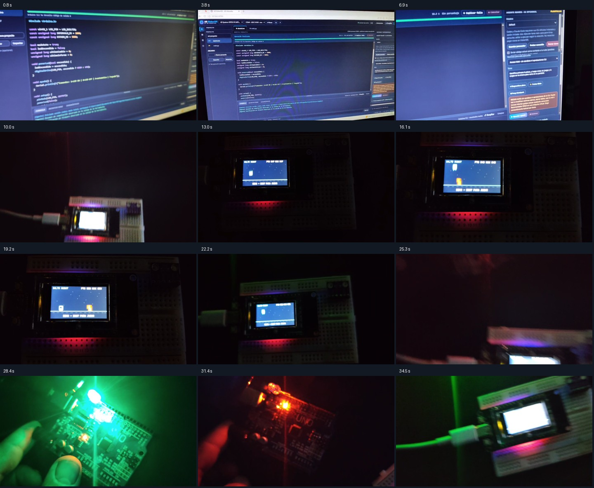

# Vídeo de evidencia aportado por el usuario · 25 de octubre de 2026

Original: [video_2026-10-25_00-52-16.mp4](video_2026-10-25_00-52-16.mp4). Se conserva sin edición, con audio original.

- Duración: 36.79 segundos. Resolución: 1280 × 720. Tamaño: 15,074,247 bytes.
- SHA-256: `d64e193912803be5691b960c2e3e2245dca10b5a957425a4d50059f1646e7423`.
- Procedencia: archivo facilitado por el usuario desde su carpeta Videos. El nombre y la fecha del archivo no se tratan como una prueba independiente de cuándo se grabó.
- Revisión: doce fotogramas distribuidos por el clip, con ampliación de dos fotogramas. No se ha analizado ni transcrito el audio.

## Contenido visible

| Tiempo aproximado | Observación |
| --- | --- |
| 0–8 s | MakerIDE en un monitor. La dirección visible es `127.0.0.1:8765`. La interfaz muestra «Operación finalizada» y «Arduino CLI ha devuelto código de salida 0». En la consola se ven mensajes de un agente sobre compilación y verificación de firmware. |
| 9–25 s | Dispositivo físico conectado por USB, sobre una placa de prototipos, con un juego en la pantalla. Se distinguen el título «SALTO ROBOT», un personaje, obstáculos y distintos estados entre los fotogramas. |
| 27–36 s | Una placa con la inscripción UNO e indicadores luminosos; al final vuelve a aparecer el dispositivo con pantalla. |

## Alcance de esta evidencia

La grabación aporta observación visual del juego funcionando en una pantalla física y de una placa UNO encendida, además del resultado mostrado en MakerIDE. Se registra como **evidencia de campo aportada por el usuario**, separada de las pruebas ejecutadas por Codex.

No se ha repetido la grabación de firmware ni abierto un puerto serie para incorporar este archivo. No se puede vincular de forma inequívoca la grabación a un commit, firmware, versión exacta de MakerIDE, modelo concreto del dispositivo con pantalla ni a la candidata RC1. Tampoco se deduce que ambas placas compartan el mismo firmware.

En el fotograma de unos 3,8 s se ve COM4 con CH340 y un modelo del selector cuyo nombre empieza por «4D Systems ESP32-P4 MIPI…». Ese texto documenta la selección mostrada, y no acredita la identificación física de la placa. El vídeo se realizó en el origen 8765; no verifica por sí solo el robot ni las correcciones de la candidata servida en 8770.

Se mantienen los pendientes de lanzamiento de RELEASE_RC1.md: validación física reproducible por modelo, vinculación a versión/firmware y pruebas de los flujos concretos. Las omisiones de g++ tampoco cambian por esta grabación.

## Conservación

El MP4 original, esta ficha, sus metadatos y la hoja de doce fotogramas se incorporaron primero al Git local. El 25 de octubre de 2026, tras la autorización de publicación del autor, se incluyeron en el repositorio público y la entrega RC1. La observación del vídeo y sus límites siguen siendo los descritos arriba.

